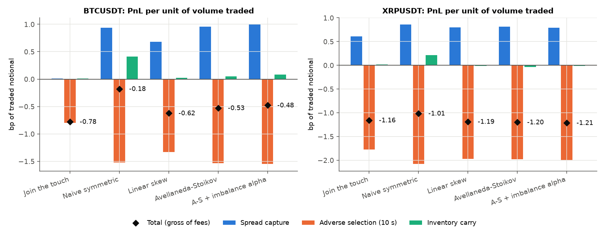
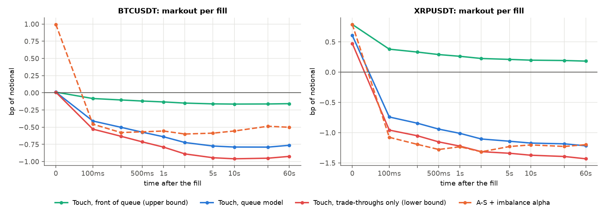
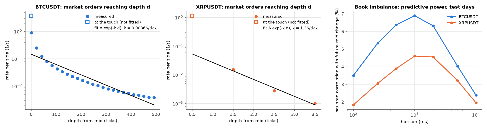
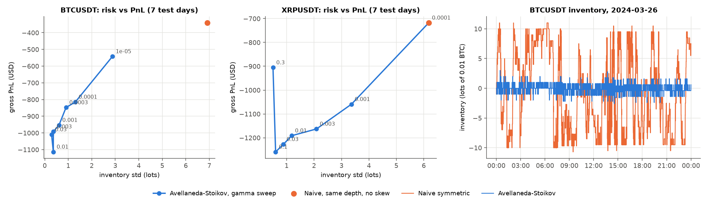
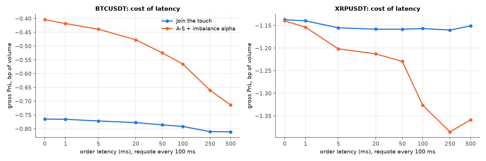

# crypto-market-making

[](https://github.com/lucaspaulien/crypto-market-making/actions/workflows/ci.yml)
[](LICENSE)

An event-driven **market-making backtester** replayed on real Binance
USD-M perpetual data -- every best-bid/ask change and every trade of
**BTCUSDT** and **XRPUSDT** over 8 days (~150 million book updates) -- and a
study of where a market maker's PnL actually comes from.

The simulator models what decides a market maker's life: **its place in the
queue**, **latency** between decision and order arrival, **post-only**
rejections, trade-throughs and crossed books. Strategies range from "join the
touch" to the **Avellaneda-Stoikov** optimal quotes (closed form of Gueant,
Lehalle & Fernandez-Tapia), calibrated on one day and tested out of sample on
the next seven, plus an **order-book-imbalance alpha**. Every dollar of PnL is
attributed exactly to **spread capture, adverse selection, inventory carry and
fees**.

The core loop is compiled with numba: one BTCUSDT day (13 million events)
simulates in ~0.3 s, so every configuration below is a full 7-day run.

## Headline result

Seven out-of-sample days (2024-03-24 to 03-30), quotes of ~USD 650 per side,
inventory capped at 10 lots, 20 ms latency, requote every 100 ms. Gross PnL
in **basis points of traded notional** (fees analysed separately below):

| | BTCUSDT | XRPUSDT |
|---|---:|---:|
| Tick size, in bp of price | 0.015 bp | 1.6 bp |
| **Join the touch, back of the queue** (realistic queue model) | **-0.78 bp** (0/7 days up) | **-1.16 bp** (0/7) |
| Join the touch, **front of the queue** (upper bound) | -0.16 bp (0/7) | **+0.19 bp (7/7)** |
| Front of the queue **+ imbalance alpha** | -0.06 bp (2/7) | **+0.67 bp (7/7)**, USD +8.7k on 129M |
| Avellaneda-Stoikov + imbalance alpha (queue model) | -0.48 bp | -1.21 bp |

Three findings carry the whole project:

1. **In a one-tick market the edge is the queue, not the spread.** BTCUSDT
   trades at a one-tick spread 93-98% of the time depending on the day:
   half a tick is 0.008 bp of edge per fill, while the mid moves 0.6 bp against a filled order within
   one second. The *same* strategy goes from -0.78 bp at the back of the
   queue to -0.16 bp at the front on BTC, and from -1.16 bp to +0.19 bp on
   XRP: **queue priority is worth 0.6 to 1.35 bp of every dollar traded**,
   more than any quoting formula. Back-of-queue orders only fill when the
   whole level is being eaten, which is exactly when the price is about to
   move through it.
2. **The taker flow is informed at sub-second horizons**, and that shows up
   in the data independently of the simulator: after a burst of market
   orders, the BTC mid moves on average 16 ticks further in the aggressor's
   direction within one second (83 ticks volume-weighted; measured on
   2024-03-24). For every strategy quoting away from the touch, adverse
   selection costs 1.3 to 2.1 bp of volume against 0.6 to 1.0 bp of spread
   capture; at the touch on BTC, spread capture is essentially zero.
3. **Avellaneda-Stoikov does its job, which is inventory control, not
   alpha.** At the same quoting depth it cuts the BTC inventory standard
   deviation from 6.9 to 0.6 lots (11x) and the worst intraday position from
   the 10-lot limit to about 3. The naive quoter's better weekly PnL
   (-0.18 bp vs -0.53 bp) is entirely its inventory carry (+0.41 bp), that is
   a directional bet that happened to pay over these seven days.

<p align="center">
  
</p>

*Exact attribution of the gross PnL, per unit of volume. Spread capture (blue)
is what fills earn against the mid at the moment they happen; adverse
selection (orange) is the mid moving against them in the next 10 seconds;
inventory carry (green) is what the position does afterwards. The three bars
sum exactly to the black diamond.*

## What it would take to make money

Fees are a linear shift of the numbers above: a maker fee of `f` bp removes
`f` bp of volume. Binance's base-tier USD-M maker fee is 2 bp; top-tier
liquidity-provider programs pay rebates instead (the -0.5 bp below is an
illustrative order of magnitude, not a quoted schedule).

| Net PnL, bp of volume | gross | 2 bp maker fee | 0.5 bp rebate |
|---|---:|---:|---:|
| BTC, touch, back of queue | -0.78 | -2.78 | -0.28 |
| BTC, touch + alpha, front of queue | -0.06 | -2.06 | **+0.44** |
| XRP, touch, back of queue | -1.16 | -3.16 | -0.66 |
| XRP, touch + alpha, front of queue | **+0.67** | -1.33 | **+1.17** |

None of this survives retail fees. What turns it positive is the combination
professional market makers actually compete on: **queue priority** (being
there first, at the right price), **a short-term fair-value signal** to
step away before being run over, and **a fee rebate**. The quoting formula
matters much less.

## The simulator

`src/mmsim/simulator.py` replays three time-ordered streams -- trades,
best-bid/ask updates, and the strategy's own clock -- with prices stored as
integer ticks, so every comparison is exact:

- **Latency.** Each `requote_ms` the strategy decides its quotes from the
  book it sees; the orders go live `latency_ms` later (decisions in flight
  are queued, so latency can exceed the requote interval). Re-quoting at an
  unchanged price keeps the order and its queue position.
- **Post-only.** An order that would cross the book on arrival is rejected,
  like Binance GTX orders.
- **Queue position.** Joining the best bid puts the order behind the whole
  displayed size; improving the best bid puts it first; quoting behind the
  best bid means the queue is unknown until that level becomes the best, at
  which point the order assumes it is behind everything displayed. Trades at
  our price consume the queue ahead first, and size cancelled from the level
  moves us up (capped at the displayed size).
- **Fills.** A trade at our price fills us once the queue ahead is gone; a
  trade *through* our price fills us entirely (price-time priority means our
  whole level was taken first); a book that crosses our resting order fills
  it at our price. `fill_model='touch'` (front of queue) and `'through'`
  (trade-throughs only) bound the queue model from above and below.
- **Same-millisecond events** run trades, then book updates, then order
  arrivals, then the clock, so the volume of a trade is never counted twice
  against the queue.

Every fill is tagged as filled at price, trade-through, or crossed. On BTC
at the touch, 54% of fills happen at price, 26% through and 19% by a crossed
book, and the latter two are the most toxic (on 2024-03-24: -0.8 and -0.6 bp
markout at 1 s, against -0.5 bp for fills at price).

**What is not modelled:** our own impact on other participants, queue
changes hidden inside the displayed size (orders cancelled *ahead* of us),
and depth beyond the top of book (the public data has the best level only).
Each day starts flat and is marked to the mid at the end, without a
liquidation cost.

<p align="center">
  
</p>

*Markouts: PnL per fill marked to the mid h after the fill. At h = 0 it is
the spread captured; the drop over the next second is the adverse
selection. Only the front-of-queue XRP curve stays above zero.*

## Strategies

`src/mmsim/strategies.py`; distances in ticks from the mid, inventory `q` in
lots.

- **Join the touch**: best bid and best ask, whatever happens.
- **Naive symmetric**: mid +/- a fixed half-spread, optionally with a linear
  inventory skew.
- **Avellaneda-Stoikov (GLFT closed form)**. With market orders reaching
  depth `d` at rate `A exp(-k d)`, mid volatility `sigma` and risk aversion
  `gamma`, the stationary optimal quotes are

  ```
  delta_bid(q) = c1 + (2q + 1)/2 * c2          delta_ask(q) = c1 - (2q - 1)/2 * c2
  c1 = (1/gamma) ln(1 + gamma/k)
  c2 = sqrt( sigma^2 gamma / (2 k A) * (1 + gamma/k)^(1 + k/gamma) )
  ```

  `c1` is the half-spread a risk-neutral maker would quote against this flow;
  `c2` is how far each lot of inventory shifts both quotes.
- **Imbalance alpha**: any strategy can centre its quotes on
  `mid + alpha * (bid_qty - ask_qty) / (bid_qty + ask_qty)`, with `alpha`
  fitted on the calibration day (21 ticks on BTC, 0.34 tick on XRP).

**Calibration** (`calibration.py`, first day only). `sigma` comes from
1-second mid changes. For `A` and `k`, each burst of market orders (one side,
one millisecond, possibly sweeping several levels) is measured by the
deepest level it reached, and `log(rate of bursts reaching depth >= d)` is
fitted linearly in `d`. Two lessons from doing it on real data:

- the touch itself does not fit: its rate is 20 to 25 times above the
  exponential through the deeper levels, because filling *at* the touch is a
  queue question rather than a distance question, so it is excluded from the
  fit;
- on BTC the distribution is far from exponential (the fit is off by a
  factor 6 just beyond the touch and by 2 in the far tail), so the model's optimal depth (~110 ticks, about
  USD 11) rests on a misspecified intensity. A-S is only as good as its
  order-flow model.

<p align="center">
  
</p>

**The imbalance signal holds out of sample.** With the calibration-day
slope, it explains 1.6% to 8.0% of the variance of the next-second BTC mid
change on each of the seven test days (3.3% to 6.5% on XRP), with a peak at
a 1 to 2 second horizon. On BTC it improves Avellaneda-Stoikov from -0.53 to
-0.48 bp and cuts the loss of the touch strategy by a third, mostly by
skipping the fills that would have been run over. On XRP, at the back of the
queue, it does not help: the toxic fills there come from crossed books that
the signal cannot anticipate at a 100 ms requote. At the front of the queue
it is worth +0.48 bp.

<p align="center">
  
</p>

*Left and centre: raising `gamma` trades PnL for inventory risk, as the
model says it should. Right: a day of inventory. The naive quoter sits at the
limit for hours; A-S keeps it within a couple of lots.*

## Latency

<p align="center">
  
</p>

The touch strategy barely depends on latency: it is always last in the queue
anyway. The alpha-driven strategy is the one that pays for speed. On BTC its
loss grows from 0.40 bp at 0 ms to 0.71 bp at 500 ms, because a signal with a
1-second half-life is worth little when the quotes arrive a quarter of a
second late.

## Correctness: how this is verified

`pytest -v` runs 27 tests, all passing:

- **`tests/test_simulator.py`**: hand-built books where the right answer is
  known. The queue ahead is consumed before we fill; cancellations move us
  up; a trade-through fills the whole order whatever its size; a crossing
  book fills at our price and is measured against the mid *before* the
  move; an order improving the spread has no queue; a deeper order learns
  its queue when its level becomes best; latency delays orders, including
  latency longer than the requote interval; post-only rejections; requoting
  at the same price keeps queue position; the three fill models order
  correctly; inventory limits hold; inventory skew reduces inventory.
- **`tests/test_pnl.py`**: on random markets, the four attribution terms sum
  **exactly** to the net PnL and to the final equity; cash and inventory
  match the fill log; passive trade fills never pay the spread; fees cost
  exactly rate x notional; the markout at 0 is the spread capture.
- **`tests/test_strategies_calibration.py`**: GLFT quote properties
  (symmetric when flat, inventory skew in the right direction, the
  risk-neutral limit `c1 -> 1/k`); the intensity fit recovers a known
  exponential to within 3%; burst depth on a hand-built sweep; volatility and
  imbalance slope on a synthetic book; Binance file conversion round-trip,
  including the `is_buyer_maker` sign convention.

Writing them caught three bugs: the final PnL was read from the last clock
sample rather than the true end state; decisions in flight were overwritten
when latency exceeded the requote interval (no order ever arrived); and
fills from crossed books were first measured against the post-move mid.

## Project layout

```
crypto-market-making/
├── src/mmsim/
│   ├── data.py          # Binance download, conversion to integer-tick .npz, loading
│   ├── simulator.py     # numba event loop: queue, latency, post-only, fills
│   ├── strategies.py    # touch, fixed spread + skew, Avellaneda-Stoikov (GLFT), imbalance alpha
│   ├── calibration.py   # sigma, A/k from market-order bursts, imbalance slope
│   ├── pnl.py           # exact attribution, markouts, summary statistics
│   └── backtest.py      # multi-day runs, aggregation
├── scripts/
│   ├── download_data.py     # fetch + convert bookTicker / aggTrades days
│   ├── run_experiments.py   # every table above -> docs/*.csv
│   └── make_figures.py      # docs/*.png
├── tests/                   # 27 tests, hand-built and synthetic markets
└── docs/                    # results CSVs and figures from the real-data run
```

## Running it

```bash
python -m venv .venv && source .venv/bin/activate
pip install -e ".[dev]"
pytest -v                                         # no data needed

# ~1.2 GB of zips downloaded, ~0.9 GB once converted; bookTicker files exist up to 2024-03-30
python scripts/download_data.py --symbols BTCUSDT XRPUSDT --start 2024-03-23 --end 2024-03-30
python scripts/run_experiments.py                 # ~5 min
python scripts/make_figures.py
```

```python
from mmsim.data import load
from mmsim.simulator import simulate
from mmsim.strategies import Touch

md = load('BTCUSDT', ['2024-03-24'], 'data')
res = simulate(md, Touch(), size=0.01, latency_ms=20, fill_model='queue')
res.attribution()   # spread_capture, adverse_selection, inventory_carry, fees, net (USD)
res.markouts()      # bp per fill at 0 ms ... 5 min
```

## Known limitations

1. **Top of book only.** Binance's public archive has the best level, not the
   full depth, so queues behind the touch are only learned when the level
   becomes the best, and the depth of our own level is the displayed size at
   that moment.
2. **One week, two symbols, one market regime** (late March 2024). The
   front-of-queue results are an upper bound by construction, and seven
   positive days are evidence, not proof.
3. **No market impact of our own orders**: at USD 650 per quote that is
   reasonable for BTC and XRP perpetuals, not for size.
4. **Clock-driven requoting** (every 100 ms) instead of reacting to every
   book event, which is what the fastest firms do. The latency study
   bounds how much that costs.
5. **Daily resets**: each day starts flat and is marked to the mid at
   midnight, with no liquidation cost or overnight funding.
6. **The inventory limit is checked when quotes are decided**, so with
   orders in flight it can be overshot by one lot (the naive quoter touches
   11 lots against a limit of 10).

## References

- Avellaneda, M. & Stoikov, S. (2008). *High-frequency trading in a limit
  order book*. Quantitative Finance, 8(3), 217-224.
- Gueant, O., Lehalle, C.-A. & Fernandez-Tapia, J. (2013). *Dealing with the
  inventory risk: a solution to the market making problem*. Mathematics and
  Financial Economics, 7(4), 477-507.
- Cartea, A., Jaimungal, S. & Penalva, J. (2015). *Algorithmic and
  High-Frequency Trading*. Cambridge University Press.
- Moallemi, C. & Yuan, K. (2017). *A model for queue position valuation in a
  limit order book*. Working paper, Columbia Business School.
- Cont, R., Kukanov, A. & Stoikov, S. (2014). *The price impact of order book
  events*. Journal of Financial Econometrics, 12(1), 47-88.

## License

MIT. See `LICENSE`. Market data from Binance's public archive
(data.binance.vision), not included in the repository.
